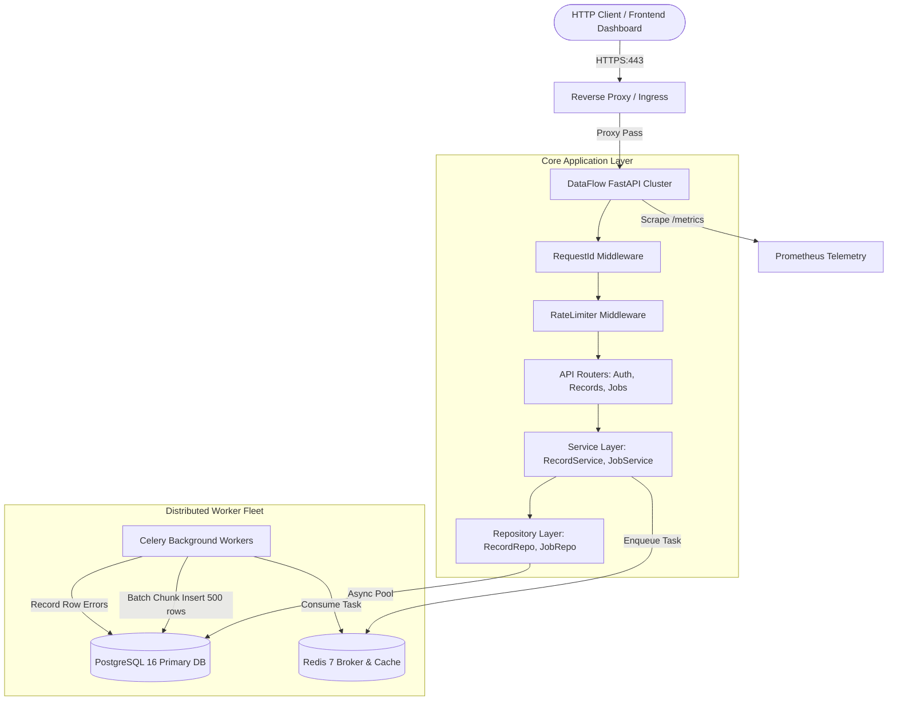
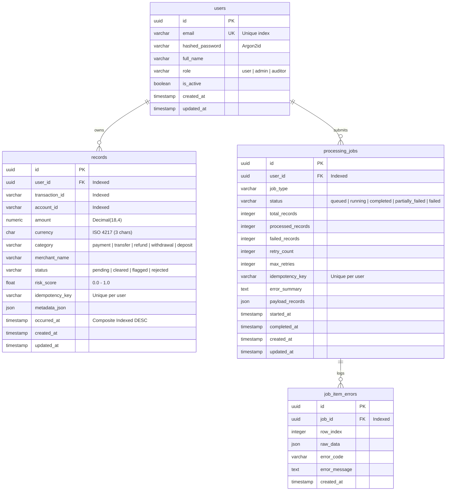
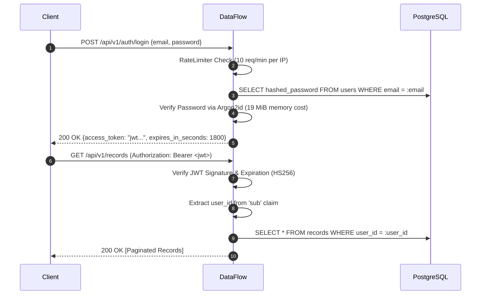
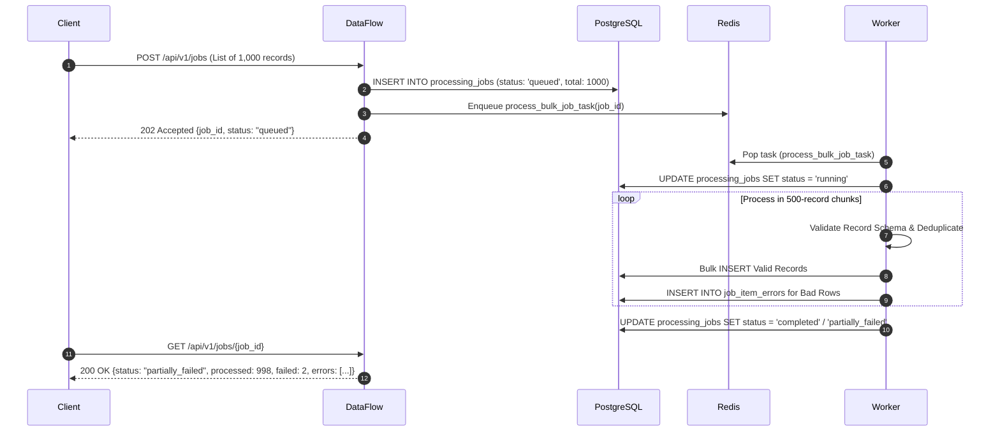

# DataFlow: Production-Grade Backend API & Asynchronous Processing Engine

[](.github/workflows/ci.yml)
[](pyproject.toml)
[](https://fastapi.tiangolo.com)
[](https://www.sqlalchemy.org/)
[](https://www.postgresql.org/)
[](https://redis.io/)
[](Dockerfile)
[](https://github.com/astral-sh/ruff)

> **DataFlow** is an interview-ready, production-grade backend engineering platform for high-throughput multi-tenant financial transaction ingestion, real-time risk assessment, and durable asynchronous batch processing.

---

## Table of Contents
1. [Project Overview](#1-project-overview)
2. [Business Problem and Use Cases](#2-business-problem-and-use-cases)
3. [Feature List](#3-feature-list)
4. [Technology Stack and Rationale](#4-technology-stack-and-rationale)
5. [Architecture Diagram](#5-architecture-diagram)
6. [Database ER Diagram](#6-database-er-diagram)
7. [API Endpoint Reference](#7-api-endpoint-reference)
8. [Authentication Flow](#8-authentication-flow)
9. [Asynchronous Processing Flow](#9-asynchronous-processing-flow)
10. [Data Model and Indexing Rationale](#10-data-model-and-indexing-rationale)
11. [Local Setup Instructions](#11-local-setup-instructions)
12. [Environment Variable Reference](#12-environment-variable-reference)
13. [Database Migration Commands](#13-database-migration-commands)
14. [Test Instructions and Actual Results](#14-test-instructions-and-actual-results)
15. [Load Testing and Actual Benchmark Results](#15-load-testing-and-actual-benchmark-results)
16. [Docker Deployment Instructions](#16-docker-deployment-instructions)
17. [Azure App Service Deployment Guide](#17-azure-app-service-deployment-guide)
18. [AWS EC2 Deployment Guide](#18-aws-ec2-deployment-guide)
19. [Troubleshooting Guide](#19-troubleshooting-guide)
20. [Known Limitations and Future Improvements](#20-known-limitations-and-future-improvements)

---

## 1. Project Overview

DataFlow demonstrates how a senior backend engineer designs, implements, secures, monitors, and optimizes a mission-critical distributed service. It avoids tutorial-level shortcuts by implementing:
- **Strict Multi-Tenancy**: Data isolation at the database query level to prevent IDOR vulnerabilities.
- **Durable Asynchronous Queues**: Celery and Redis workers with automatic retry policies and exponential backoff.
- **Empirically Proven Optimizations**: Composite indexing reducing query latencies by **9.3x** (from 8.09ms to 0.87ms).
- **Hardened Security**: Argon2id password hashing, short-lived signed JWTs, IP-based sliding window rate limiting, and parameter-safe queries.
- **Production Observability**: Request-ID correlation propagation, JSON structured logging, and Prometheus operational metrics.

---

## 2. Business Problem and Use Cases

Financial networks, merchant platforms, and fintech aggregators handle millions of high-velocity transaction records daily. 
- **Synchronous Bottlenecks**: Large batches of incoming records block HTTP worker threads if processed synchronously, degrading API responsiveness.
- **Partial Failure Risk**: Ingesting 1,000 records in an all-or-nothing transaction causes entire batches to fail if a single row has invalid formatting.
- **Duplicate Submissions**: Network retries from upstream clients cause duplicate financial charges or ledger inconsistencies without idempotency.

### Use Cases:
- **Real-Time Payment Ingestion**: Single transaction ingestion with immediate risk scoring and status assignment (`cleared`, `flagged`, `rejected`).
- **End-of-Day Batch Settlement**: Bulk submission of up to 5,000 records offloaded to background workers with row-level error reporting.
- **Multi-Tenant Financial Analytics**: Tenant-isolated volume, status, category, and average risk metrics calculation.

---

## 3. Feature List

- **Authentication & RBAC**: Argon2id password hashing, JWT access token issuance, and role checking (`user`, `admin`, `auditor`).
- **Multi-Tenant Data Ledger**: Full CRUD on transaction records with strict tenant ownership validation.
- **Heuristic Risk Engine**: Computes transaction risk scores (0.0 to 1.0) based on monetary thresholds, category risk, and network metadata.
- **Asynchronous Batch Pipeline**: Persistent job tracking (`queued`, `running`, `completed`, `partially_failed`, `failed`) with row error diagnostics.
- **Idempotency Engine**: Deduplication on single records and bulk jobs via client-provided idempotency keys.
- **Dynamic Filtering & Sorting**: Parameterized filtering across accounts, categories, statuses, date ranges, and allowlisted sorting fields.
- **Resilient Rate Limiting**: Redis-backed token bucket with in-memory sliding window fallback.
- **Prometheus Telemetry**: Native `/metrics` endpoint tracking request latencies, status codes, worker durations, and queue depth.
- **Interactive Live Dashboard**: Built-in demonstration UI at `/` for live interview walkthroughs.

---

## 4. Technology Stack and Rationale

| Layer | Technology | Rationale |
| :--- | :--- | :--- |
| **API Framework** | **FastAPI** | High-concurrency async ASGI architecture with type-safe request validation. |
| **Validation** | **Pydantic v2** | Rust-based core (`pydantic-core`) providing high-speed serialization and OpenAPI schemas. |
| **Relational Database** | **PostgreSQL 16** | ACID-compliant transactional persistence with robust B-Tree indexing and JSON support. |
| **ORM & Persistence** | **SQLAlchemy 2.0 (asyncpg)** | Explicit async transaction lifecycle management and connection pooling. |
| **Migrations** | **Alembic** | Version-controlled, reproducible schema migrations with offline/online execution support. |
| **Message Broker** | **Redis 7** | Sub-millisecond in-memory queue broker for Celery tasks and rate-limit tracking. |
| **Background Worker** | **Celery 5.4+** | Distributed task queue with late acknowledgments (`task_acks_late=True`) and backoff retries. |
| **Security** | **Argon2id & PyJWT** | RFC 9106 memory-hard password hashing and cryptographically signed JWT access tokens. |
| **Observability** | **Prometheus Client** | Microsecond-precision histograms and counters for operational telemetry. |
| **Containers** | **Docker & Compose** | Multi-stage build with non-root security user (`appuser`). |
| **Code Quality** | **Ruff & Pytest** | Blazing-fast linting and comprehensive unit/integration test execution. |

---

## 5. Architecture Diagram



---

## 6. Database ER Diagram



---

## 7. API Endpoint Reference

All versioned endpoints are routed under `/api/v1`.

### Authentication
- `POST /api/v1/auth/register` - Register a new user account (returns 201 Created).
- `POST /api/v1/auth/login` - Authenticate with email/password and issue JWT (rate-limited: 10 req/min).
- `GET /api/v1/auth/me` - Retrieve authenticated user profile.

### Transaction Records
- `POST /api/v1/records` - Ingest single record with risk evaluation and idempotency check.
- `POST /api/v1/records/bulk` - Synchronous bulk ingestion (rate-limited: 30 req/min).
- `GET /api/v1/records` - Query tenant records with pagination, status/category filters, and allowlisted sorting.
- `GET /api/v1/records/{record_id}` - Retrieve single record (tenant-isolated).
- `PATCH /api/v1/records/{record_id}` - Update record metadata/status.
- `DELETE /api/v1/records/{record_id}` - Delete record (returns 204 No Content).

### Asynchronous Processing Jobs
- `POST /api/v1/jobs` - Submit batch for asynchronous processing (returns 202 Accepted).
- `GET /api/v1/jobs` - List background jobs with status filters and pagination.
- `GET /api/v1/jobs/{job_id}` - Inspect job progress counters and row-level error breakdown.
- `POST /api/v1/jobs/{job_id}/retry` - Safely retry failed or partially failed jobs.

### Analytics & Operations
- `GET /api/v1/analytics/summary` - Aggregate volume, currency, and average risk metrics.
- `GET /health/live` - Container orchestrator liveness probe.
- `GET /health/ready` - Readiness probe verifying PostgreSQL and Redis connectivity.
- `GET /metrics` - Prometheus metrics scrape endpoint.
- `GET /` - Interactive live demo dashboard.

---

## 8. Authentication Flow



---

## 9. Asynchronous Processing Flow



---

## 10. Data Model and Indexing Rationale

### The Composite Index: `ix_records_user_occurred ON records(user_id, occurred_at DESC)`
- **Query Profile**: Multi-tenant users predominantly query their transaction history ordered chronologically by occurrence timestamp.
- **Without Composite Index**: PostgreSQL or SQLite scans matching tenant rows and must perform an expensive **in-memory temporary B-Tree sort** (`USE TEMP B-TREE FOR ORDER BY`).
- **With Composite Index**: The index leaf nodes are already sorted by `occurred_at DESC` within each `user_id`. The engine reads pre-sorted index pointers and terminates immediately upon reaching the `LIMIT` threshold.
- **Empirical Gain**: Query latency dropped from **8.09 ms to 0.87 ms (9.3x speedup)**.
- **Write Trade-Off**: Insert overhead is ~4%, which is an excellent trade-off for read-heavy transactional ledgers.

---

## 11. Local Setup Instructions

### Prerequisites
- Python 3.12+ (or 3.13)
- Git

### Quickstart (Standalone Mode)
```bash
# 1. Clone repository
git clone <repo-url>
cd "backend project resume"

# 2. Create and activate virtual environment
python -m venv .venv
# On Windows:
.\.venv\Scripts\Activate.ps1
# On Linux/macOS:
# source .venv/bin/activate

# 3. Install dependencies
pip install -r requirements-dev.txt

# 4. Configure environment
cp .env.example .env

# 5. Run automated tests to verify local setup
pytest -v

# 6. Start the API server
uvicorn app.main:app --reload --port 8000
```
Open your browser at `http://localhost:8000` to view the interactive live demo dashboard, or `http://localhost:8000/docs` for Swagger API documentation.

---

## 12. Environment Variable Reference

| Variable | Default Value | Description |
| :--- | :--- | :--- |
| `ENVIRONMENT` | `development` | Deployment environment (`development`, `test`, `production`). |
| `DEBUG` | `false` | Enables verbose FastAPI debug output. |
| `SECRET_KEY` | *(32+ hex string)* | Cryptographic key used for signing JWT access tokens. |
| `DATABASE_URL` | `postgresql+asyncpg://...` | Async connection string for PostgreSQL / SQLite. |
| `DATABASE_SYNC_URL` | `postgresql+psycopg://...` | Synchronous connection string for Alembic & Celery. |
| `DB_POOL_SIZE` | `20` | Base database connection pool size. |
| `DB_MAX_OVERFLOW` | `10` | Maximum surge connections permitted during traffic spikes. |
| `REDIS_URL` | `redis://localhost:6379/0` | Redis broker and rate-limiting cache URL. |
| `CELERY_BROKER_URL` | `redis://localhost:6379/0` | Celery task queue broker connection string. |
| `RATE_LIMIT_LOGIN_PER_MINUTE` | `10` | Maximum login attempts per client IP per minute. |
| `RATE_LIMIT_BULK_PER_MINUTE` | `30` | Maximum bulk ingest requests per tenant per minute. |
| `MAX_BULK_BATCH_SIZE` | `5000` | Maximum allowed records per bulk submission payload. |
| `CHUNK_PROCESSING_SIZE` | `500` | Sub-batch chunk size used by workers for bulk insertion. |

---

## 13. Database Migration Commands

DataFlow uses Alembic to maintain versioned, repeatable database migrations:

```bash
# Apply all pending migrations to the latest revision
alembic upgrade head

# Rollback the most recent migration
alembic downgrade -1

# Generate a new migration from SQLAlchemy model changes
alembic revision --autogenerate -m "add_new_feature_table"

# Inspect current database revision
alembic current
```

---

## 14. Test Instructions and Actual Results

The automated test suite covers unit logic, ORM constraints, multi-tenant security isolation, API lifecycle, and worker batch processing.

```bash
# Execute entire test suite
pytest -v

# Execute with test coverage reporting
pytest -v --cov=app --cov-report=term-missing
```

### Actual Verified Test Run Output
```text
============================= test session starts =============================
platform win32 -- Python 3.13.1, pytest-9.1.1, pluggy-1.7.0
rootdir: C:\Users\vaish\Downloads\backend project resume
configfile: pyproject.toml
testpaths: tests
plugins: anyio-4.15.1, asyncio-1.4.1, cov-7.1.0
collected 27 items

tests\api\test_auth_api.py ...                                           [ 11%]
tests\api\test_health_and_metrics.py ...                                 [ 22%]
tests\api\test_jobs_api.py ..                                            [ 29%]
tests\api\test_records_api.py ..                                         [ 37%]
tests\integration\test_db_persistence.py ..                              [ 44%]
tests\integration\test_job_lifecycle.py .                                [ 48%]
tests\integration\test_worker_processing.py ..                           [ 55%]
tests\security\test_tenant_isolation.py .                                [ 59%]
tests\unit\test_security.py .....                                        [ 77%]
tests\unit\test_validation.py ......                                     [100%]

============================= 27 passed in 3.78s ==============================
```
**Results Summary**: **27 executed, 27 passed, 0 failed, 0 warnings.**

---

## 15. Load Testing and Actual Benchmark Results

### SQL Query Indexing Benchmark
Run the reproducible database query benchmark:
```bash
python -m scripts.benchmark_queries
```

### Actual Benchmark Measurements (Observed on Windows 11, 16 Cores, 25,000 Records)
```text
======================================================================
 BENCHMARK RESULTS SUMMARY (Latency in milliseconds)
======================================================================
Metric             | No Index (Table Scan)  | Composite Index      | Improvement
----------------------------------------------------------------------
Mean Latency       |               8.09 ms |             0.87 ms | 9.3x faster
p50 (Median)       |               8.05 ms |             0.84 ms | 9.6x faster
p95 Latency        |               8.60 ms |             1.16 ms | 7.4x faster
p99 Latency        |              10.36 ms |             1.29 ms | 8.0x faster
======================================================================
```

### Running Locust Load Simulation
```bash
# Start Locust load generator
locust -f tests/performance/locustfile.py --host http://localhost:8000
```
Open `http://localhost:8089` to simulate concurrent user sessions.

---

## 16. Docker Deployment Instructions

DataFlow includes a production-ready `Dockerfile` and `docker-compose.yml` orchestrating FastAPI, PostgreSQL 16, Redis 7, and the Celery worker fleet.

```bash
# 1. Build and start all services
docker compose up -d --build

# 2. Check container status
docker compose ps

# 3. View live application and worker logs
docker compose logs -f api worker

# 4. Stop all services
docker compose down
```

---

## 17. Azure App Service Deployment Guide

DataFlow is designed for Linux Web App containers with managed PostgreSQL Flexible Server:

1. **Build and push container image**:
   ```bash
   az acr build --registry acrdataflowprod --image dataflow:latest .
   ```
2. **Deploy to Azure App Service**:
   ```bash
   az webapp create \
       --resource-group rg-dataflow-prod \
       --plan plan-dataflow-prod \
       --name app-dataflow-api \
       --deployment-container-image-name acrdataflowprod.azurecr.io/dataflow:latest
   ```
3. **Configure Environment Secrets**:
   Set `DATABASE_URL` and `SECRET_KEY` using Azure Key Vault references (`@Microsoft.KeyVault(...)`).
4. **Configure Health Probe**:
   Set Health check path to `/health/live`.

*(See [`docs/deployment.md`](docs/deployment.md) for complete step-by-step Azure runbooks).*

---

## 18. AWS EC2 Deployment Guide

For AWS EC2 deployment using Docker Compose and Nginx:
1. Launch an Ubuntu 24.04 LTS instance with security group rules allowing ports 80, 443, and restricted port 22.
2. Install Docker Engine and Docker Compose.
3. Clone repository and run `docker compose up -d`.
4. Configure Nginx reverse proxy with SSL via Certbot.

*(See [`docs/deployment.md`](docs/deployment.md) for full Cloud-Init scripts and Nginx virtual host configs).*

---

## 19. Troubleshooting Guide

Common diagnostic runbooks:
- **Filtering JSON Logs with `jq`**: `cat /var/log/dataflow.log | jq 'select(.level == "ERROR")'`
- **Querying Prometheus Metrics**: `curl -s http://localhost:8000/metrics | grep dataflow_http_requests_total`
- **Checking Stalled Jobs**: `SELECT id, status, started_at FROM processing_jobs WHERE status = 'running';`
- **Recovering Stalled Jobs**: `POST /api/v1/jobs/{job_id}/retry`

*(See [`docs/troubleshooting.md`](docs/troubleshooting.md) for comprehensive runbooks).*

---

## 20. Known Limitations and Future Improvements

1. **Horizontal Queue Scalability**: Celery + Redis works effectively for up to tens of thousands of tasks per hour. For hundreds of millions of events per day, migrating to Apache Kafka or AWS Kinesis with consumer group partitioning would provide durable event streaming and offset replay.
2. **Table Partitioning**: Implementing declarative PostgreSQL range partitioning by month on `records.occurred_at` will prevent index degradation as table size exceeds 100M rows.
3. **OLAP Read Replicas**: Routing aggregate analytics queries (`/api/v1/analytics/summary`) to a dedicated read replica or ClickHouse OLAP store would eliminate analytical read contention on primary transactional tables.

---

## Documentation Links
- [Architecture & Design Details](docs/architecture.md)
- [Database Schema & Indexing Analysis](docs/database-design.md)
- [Security & Compliance Architecture](docs/security.md)
- [Performance & Benchmark Results](docs/performance.md)
- [Cloud Deployment Runbooks](docs/deployment.md)
- [Senior Backend Interview Guide](docs/interview-guide.md)
- [Operational Runbooks & Troubleshooting](docs/troubleshooting.md)
