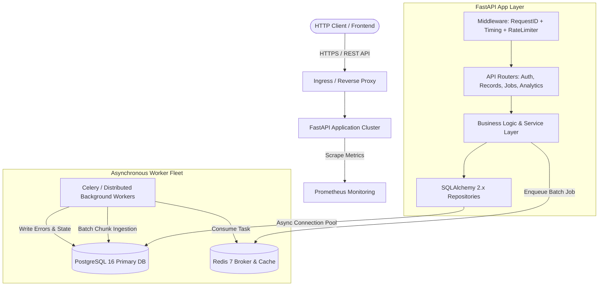
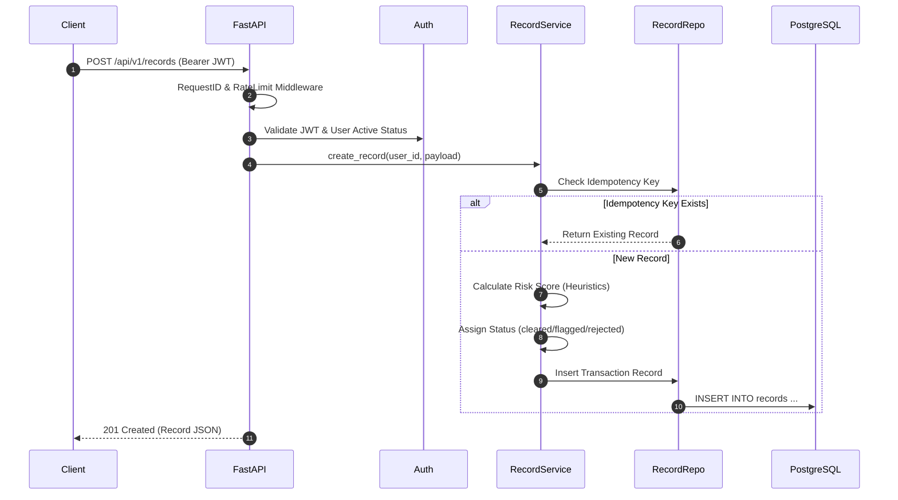
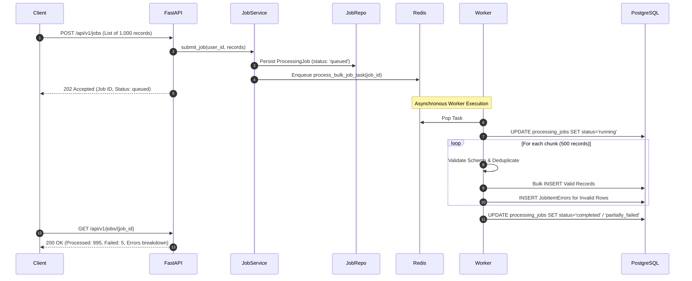

# DataFlow: System Architecture & Design Documentation

## 1. System Overview

**DataFlow** is a multi-user, multi-tenant transaction ingestion and asynchronous event processing platform designed to handle both synchronous low-latency REST operations and durable, high-throughput asynchronous batch workloads.

The service ingests financial and event transactions, enforces multi-tenant boundary checks, evaluates real-time risk scores, detects duplicate records via idempotency keys, and offloads heavy batch validation to an asynchronous worker queue.



---

## 2. Architectural Principles

1. **Separation of Concerns**:
   - **HTTP / Route Layer** (`app/api/`): Validates request shapes, injects dependencies, handles HTTP status codes. No database or business calculations reside in route functions.
   - **Service Layer** (`app/services/`): Encapsulates domain logic (e.g., transaction risk assessment, idempotency guarantees, job retry eligibility).
   - **Repository Layer** (`app/repositories/`): Isolates data persistence, SQL query composition, and tenant isolation predicates (`WHERE user_id = :uid`).
   - **Worker Layer** (`app/workers/`): Decoupled asynchronous task runner executing large workloads outside the web request lifecycle.

2. **Defense-in-Depth Multi-Tenancy**:
   - Every single record and processing job is scoped to an authenticated `user_id`.
   - Repositories enforce `WHERE user_id = :uid` on all `SELECT`, `UPDATE`, and `DELETE` operations.
   - Cross-user queries return `404 NOT_FOUND` to prevent identifier scanning and user enumeration attacks.

3. **Resilient Failure Boundaries**:
   - If Redis is temporarily unavailable, incoming batch submissions are persisted in PostgreSQL in the `queued` state. The API does not drop jobs or crash.
   - Long-running worker tasks use a 10-minute hard timeout and 9-minute soft timeout to prevent thread starvation.
   - Database connection pools use pre-ping health probes to eliminate stale socket disconnect errors.

---

## 3. End-to-End Request Lifecycles

### Synchronous Transaction Ingestion


### Asynchronous Bulk Ingestion Pipeline


---

## 4. Error Handling Contract

All application exceptions conform to a strict JSON error envelope:

```json
{
  "error": {
    "code": "VALIDATION_ERROR",
    "message": "Request validation failed. Please check your payload fields.",
    "request_id": "8b5fd681-3732-441f-8255-71ce8b99c855",
    "details": [
      {
        "field": "body -> currency",
        "issue": "Currency must be a valid 3-letter ISO code (e.g., USD, EUR)."
      }
    ]
  }
}
```

Internal tracebacks and database connection credentials are never exposed in HTTP responses.
